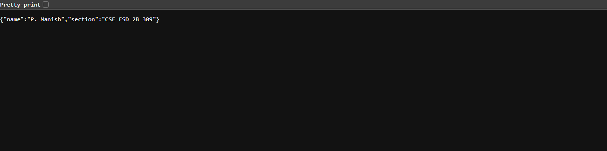
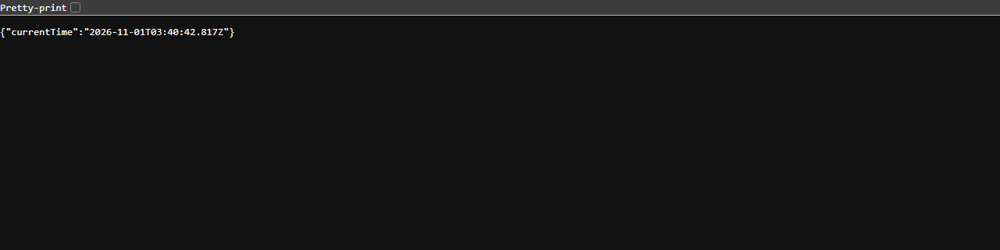

# Lab 1: Node.js and Express server

**Maduru Sampath Kumar Reddy** · Registration number **252U1R7060** · Section **CSE FSD 2B 309**


**Live link:** https://lab1bdf.vercel.app/


Course: Backend Development Fundamentals — Year II Term II — Aurora
Faculty: Joel Prashanth D

## Objective

Set up a Node.js project and build a small web server twice: first with the built-in `http` module, then with Express. The Express version exposes three routes and returns a 404 message for any unknown path.

## Technologies used

- Node.js (v18 or later)
- Express.js 4
- JavaScript
- npm
- Visual Studio Code

## Project structure

```text
lab-01/
├── api/
│   └── index.js           # Vercel entry point (imports the Express app)
├── screenshots/
│   ├── home.png
│   ├── about.png
│   ├── time.png
│   └── not-found.png
├── .gitignore
├── package.json
├── package-lock.json
├── server-http.js         # Built-in http module server
├── server.js              # Express server
├── vercel.json            # Routes all requests to api/index.js
└── README.md
```

## How to run

### Prerequisites

- Node.js installed (`node --version`)
- npm installed (`npm --version`)

### Install and start

Open a terminal in this `lab-01` folder and install the dependencies:

```bash
npm install
```

Start the Express server:

```bash
npm start
```

Then open `http://localhost:3000` in a browser.

To run the plain `http` module version instead:

```bash
npm run http
```

Stop a running server with `Ctrl + C` before starting the other one, because both use the same port.

### Environment variables

| Variable | Required | Description |
|---|---|---|
| `PORT` | No | Port the server listens on. Falls back to `3000` when it is not set. |

No other environment variables or secrets are used in this lab, so there is no `.env` file to create. Nothing sensitive is committed to the repository.

## Endpoints

| Method | Path | Description | Status |
|---|---|---|---|
| GET | `/` | Returns the welcome text. | 200 OK |
| GET | `/about` | Returns my name and section as JSON. | 200 OK |
| GET | `/time` | Returns the current date and time as JSON, generated with `new Date()`. | 200 OK |
| GET | `/anything-else` | Any unknown path returns `404 - Page not found`. | 404 Not Found |

The plain `http` server in `server-http.js` answers every request with `Hello` and status `200`.

Status codes were checked for every route in the browser and from the terminal:

```text
GET /                     -> 200
GET /about                -> 200
GET /time                 -> 200
GET /unknown-route        -> 404
```

## Screenshots

### 1. Home route — `GET /`

Returns the welcome message with status 200.


### 2. About route — `GET /about`

Returns name and section as JSON with status 200.



### 3. Time route — `GET /time`

Returns the current date and time from `new Date()` with status 200.



### 4. Unknown route — 404

Any path that is not defined returns the 404 message.


## Rules followed

- `node_modules` is not committed; it is excluded by `.gitignore`.
- No `.env` file or secret values are committed.
- Every route returns the correct status code (200 for successful routes, 404 for unknown paths).
- The repository is public.
