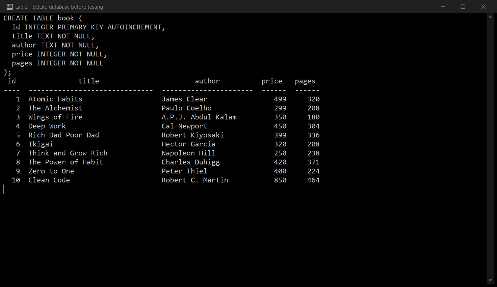
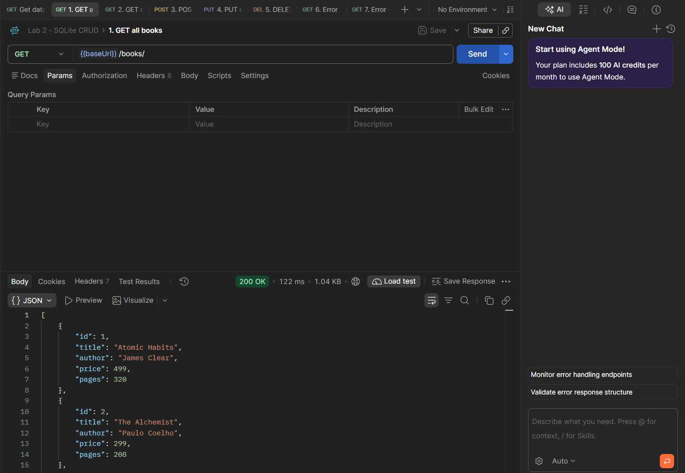
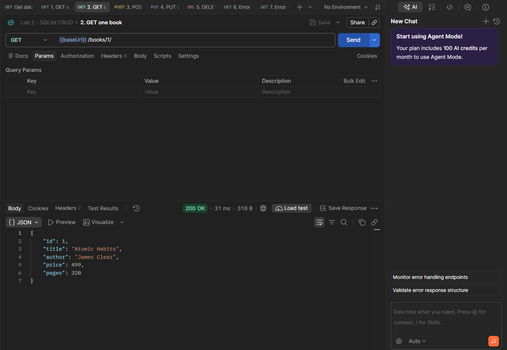
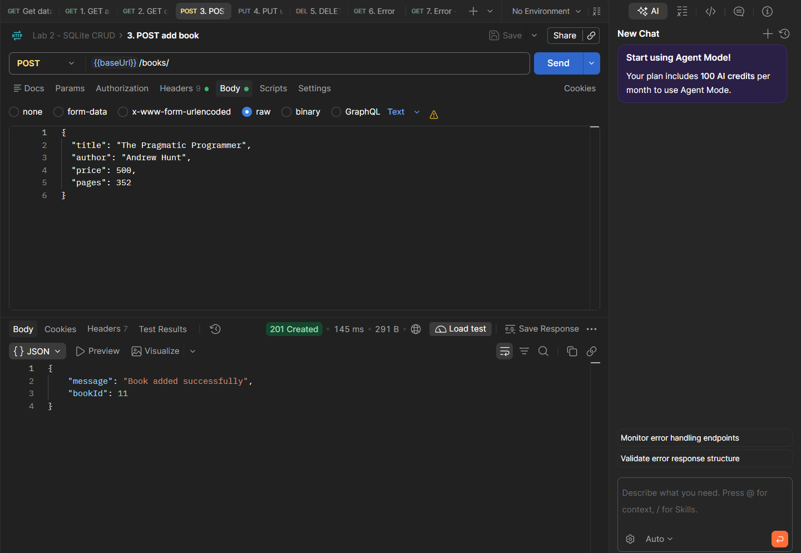
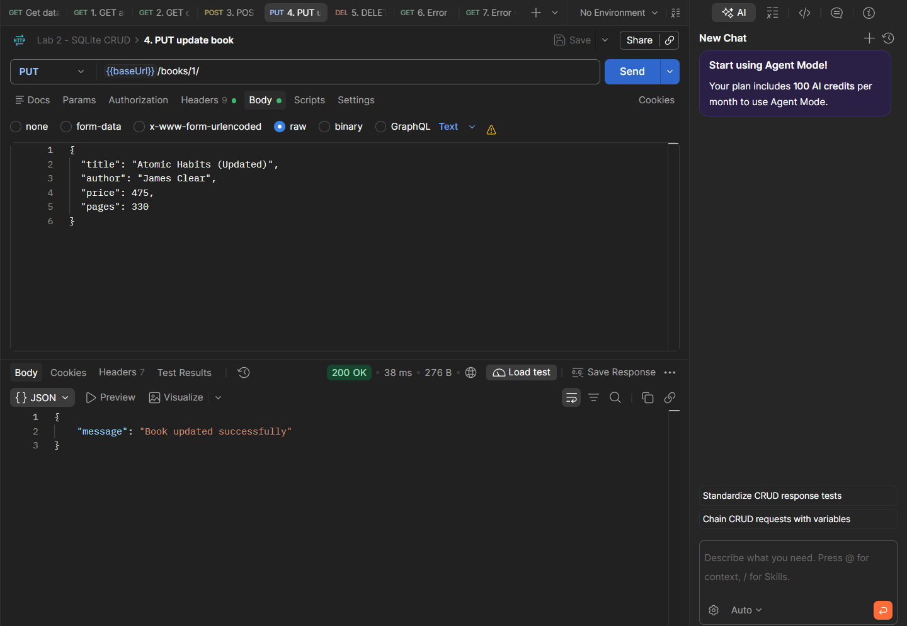
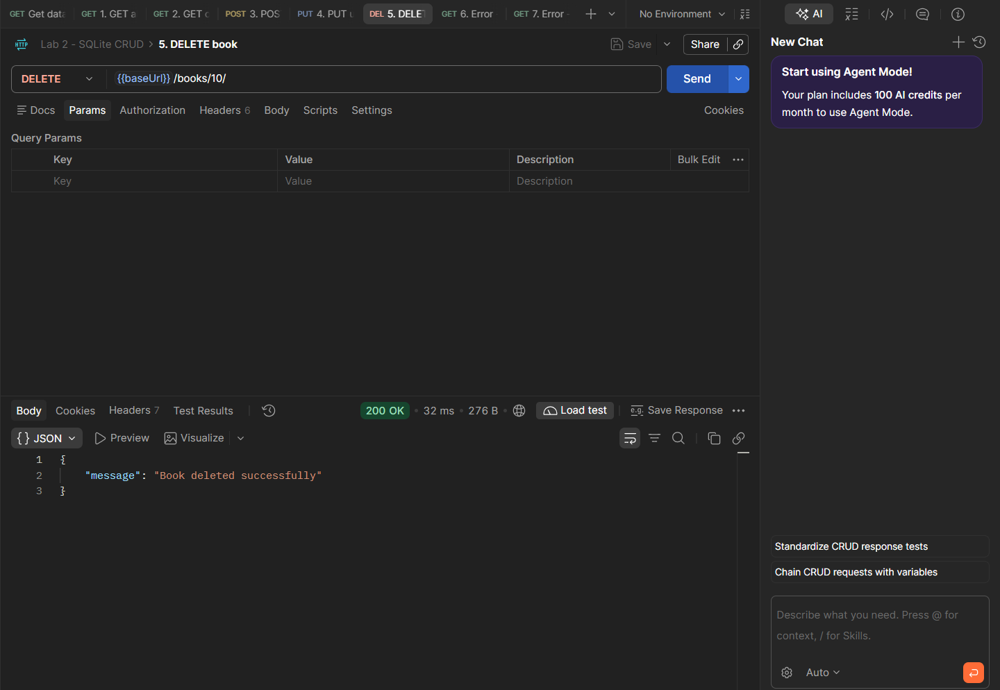
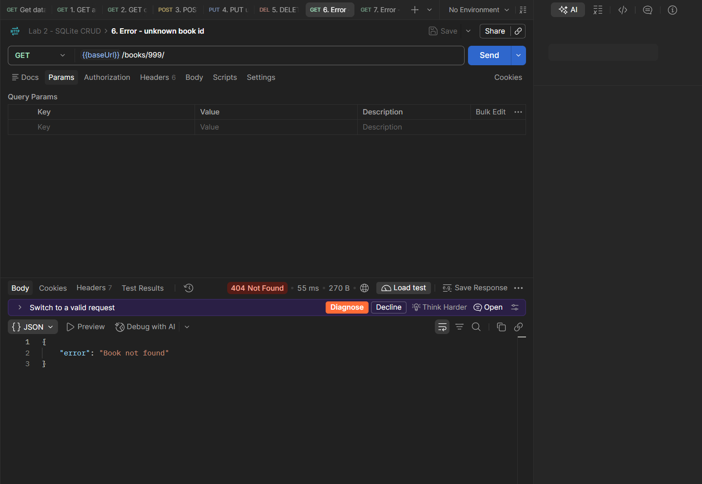
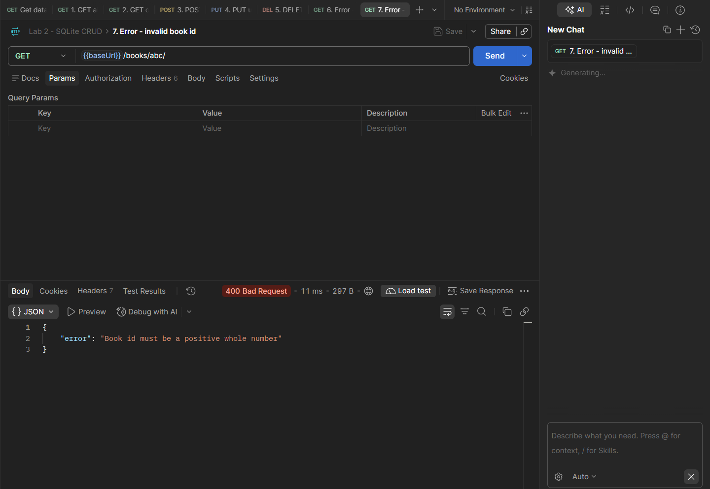
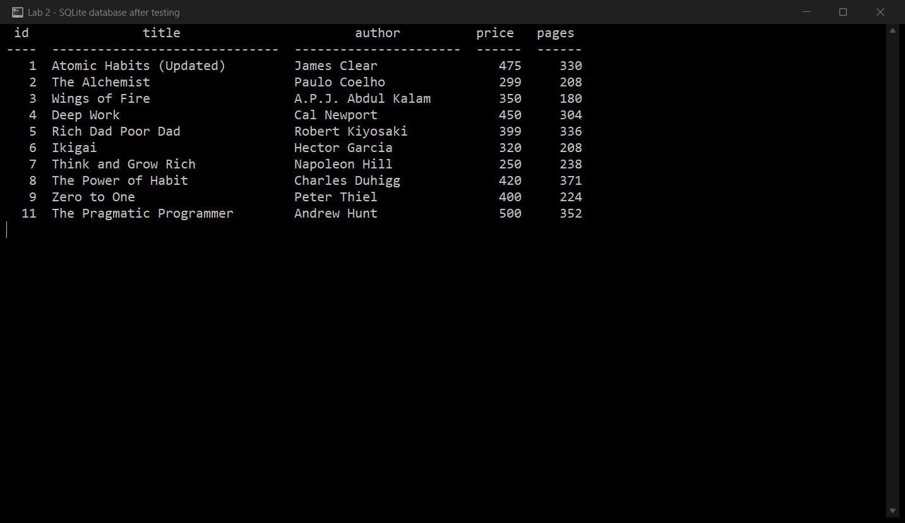

# Lab 2: SQLite database and CRUD routes

**Maduru Sampath Kumar Reddy** · Registration number **252U1R7060** · Section **CSE FSD 2B 309**

**Live link:** https://bdf-lab-02-vercel.app/

Course: Backend Development Fundamentals — Year II Term II — Aurora
Faculty: Joel Prashanth D

> The live server stores its database in `/tmp`, which is the only writable folder on Vercel. Adding, updating or deleting a book through the live link works, but the data goes back to the 10 starting rows when the server restarts. The local version keeps its changes in `books.db`.

## Objective

Connect an Express server to a SQLite database and expose create, read, update and delete operations over HTTP, so the `book` table changes after POST, PUT and DELETE.

## Technologies used

- Node.js (v18 or later)
- Express.js 4
- SQLite (`sqlite` and `sqlite3` packages)
- nodemon (development only)
- SQLite command-line shell
- Visual Studio Code

## Project structure

```text
lab-02/
├── api/
│   └── index.js           # Vercel entry point (imports the Express app)
├── screenshots/
│   ├── db-before.png
│   ├── get-all.png
│   ├── get-one.png
│   ├── post.png
│   ├── put.png
│   ├── delete.png
│   ├── error-400.png
│   ├── error-404.png
│   └── db-after.png
├── .gitignore
├── books.db               # SQLite database file (10 starting rows)
├── init.sql               # Table definition and the 10 rows
├── seed.js                # Rebuilds books.db from init.sql
├── package.json
├── package-lock.json
├── postman_collection.json # The 7 requests used for testing
├── server.js              # Express server with the CRUD routes
├── vercel.json            # Sends all requests to api/index.js
└── README.md
```

## How to run

### Prerequisites

- Node.js and npm installed (`node --version`, `npm --version`)
- The SQLite CLI is only needed if you want to create the database by hand

### Install and start

Open a terminal in this `lab-02` folder:

```bash
npm install
npm run dev
```

`npm run dev` starts the server with nodemon, so it restarts automatically on every change. The terminal prints:

```text
Server running on port 3000
```

Open `http://localhost:3000/books/` in the browser. Use `npm start` instead of `npm run dev` to run it with plain Node.

### Database

The database file `books.db` is committed, so the project works as soon as it is cloned. To rebuild it from scratch:

```bash
sqlite3 books.db < init.sql
```

or, without the SQLite CLI installed:

```bash
npm run seed
npm run seed -- --reset     # drops the table and re-inserts the 10 rows
```

To inspect the table:

```bash
sqlite3 books.db
.headers on
.mode column
SELECT * FROM book;
```

### Environment variables

| Variable | Required | Description |
|---|---|---|
| `PORT` | No | Port the server listens on. Falls back to `3000` when it is not set. |

No database password, API key or `.env` file is used in this lab, so there is nothing to keep secret. `.env` files are ignored by `.gitignore` in case they are added later.

## Endpoints

| Method | Path | Description | Success |
|---|---|---|---|
| GET | `/books/` | Returns every book in the table. | 200 |
| GET | `/books/:bookId/` | Returns the book with that id. | 200 |
| POST | `/books/` | Adds a book from the JSON body. | 201 |
| PUT | `/books/:bookId/` | Replaces the details of an existing book. | 200 |
| DELETE | `/books/:bookId/` | Deletes the book with that id. | 200 |

Request body for POST and PUT:

```json
{
  "title": "The Pragmatic Programmer",
  "author": "Andrew Hunt",
  "price": 500,
  "pages": 352
}
```

Error responses:

| Case | Status |
|---|---|
| `bookId` is not a positive whole number | 400 |
| A required field is missing or has the wrong type | 400 |
| The request body is not valid JSON | 400 |
| No book exists with that id | 404 |
| Unknown route | 404 |

Every query that uses input from the request uses `?` placeholders, for example:

```js
await db.get("SELECT * FROM book WHERE id = ?;", [bookId]);
```

## Testing

Every route was tested in Postman against the locally running server, and the result was compared with the SQLite CLI. The collection is included as `postman_collection.json`: import it into Postman and it contains all seven requests, with the `baseUrl` variable set to `http://localhost:3000`. The screenshots below show each request in Postman with its status code and response body, and the SQLite CLI screenshots show the table before and after the changes.

| Route | Status observed | Database effect |
|---|---|---|
| `GET /books/` | 200 | none |
| `GET /books/1/` | 200 | none |
| `POST /books/` | 201 | new row added, id 11 |
| `PUT /books/1/` | 200 | row 1 updated |
| `DELETE /books/10/` | 200 | row 10 removed |
| `GET /books/999/` | 404 | none |
| `GET /books/abc/` | 400 | none |

## Screenshots

### Database before testing

The `book` table and its 10 starting rows, read with the SQLite CLI.



### GET /books/ — all books

Returns every row with status 200.



### GET /books/1/ — one book

Returns the single book with id 1 and status 200.



### POST /books/ — add a book

Adds a book and returns status 201 with the new id.



### PUT /books/1/ — update a book

Updates the fields of book 1 and returns status 200.



### DELETE /books/10/ — delete a book

Deletes book 10 and returns status 200.



### Error case — unknown book id

`GET /books/999/` returns 404 because no such row exists.



### Error case — invalid book id

`GET /books/abc/` returns 400 because the id is not a positive whole number.



### Database after testing

Row 1 is updated, row 10 is gone and the book added with POST has id 11.


